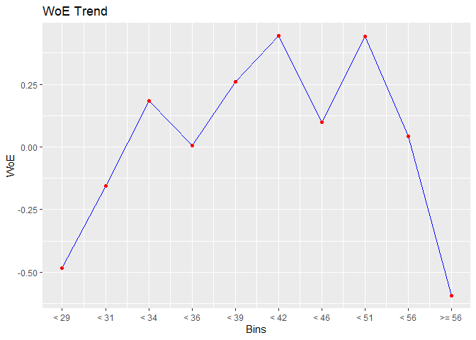
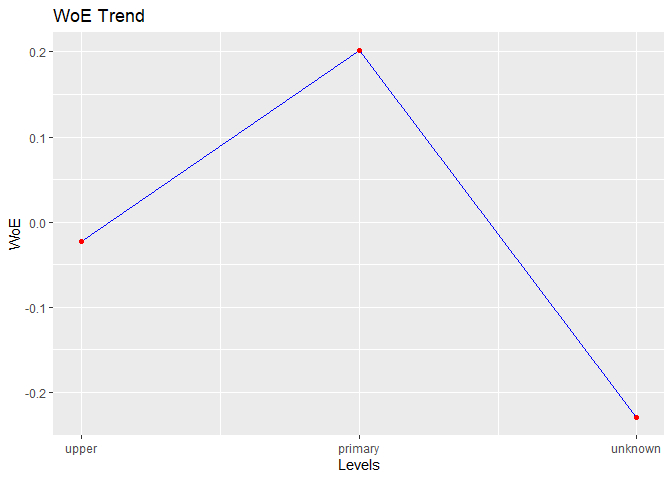
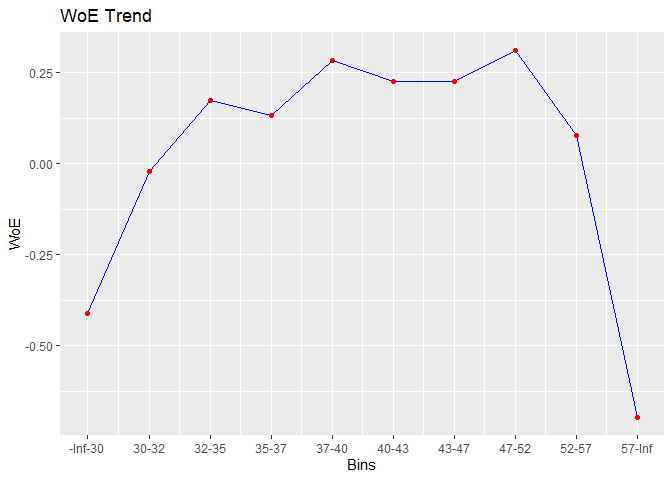
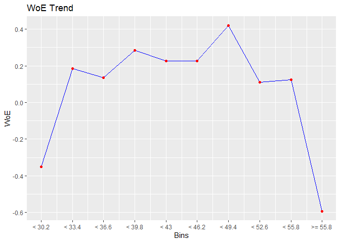
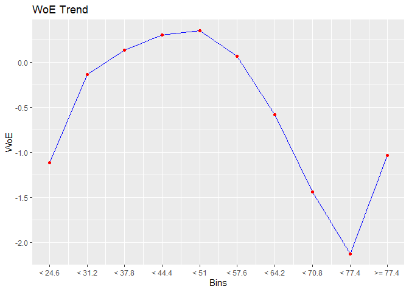

<!-- README.md is generated from README.Rmd. Please edit that file -->

# rbin

> Tools for binning data

<!-- badges: start -->

[](https://cran.r-project.org/package=rbin)
[](https://github.com/rsquaredacademy/rbin/actions/workflows/R-CMD-check.yaml)
[](https://app.codecov.io/github/rsquaredacademy/rbin?branch=master)
<!-- badges: end -->

## Installation

``` r
# Install rbin from CRAN
install.packages("rbin")

# Or the development version from GitHub
# install.packages("devtools")
devtools::install_github("rsquaredacademy/rbin")
```

## Addins

rbin includes two addins for manually binning data:

- `rbinAddin()`
- `rbinFactorAddin()`

## Usage

### Manual Binning

``` r
bins <- rbin_manual(mbank, y, age, c(29, 31, 34, 36, 39, 42, 46, 51, 56))
bins 
#> Binning Summary
#> ---------------------------
#> Method               Manual 
#> Response             y 
#> Predictor            age 
#> Bins                 10 
#> Count                4521 
#> Goods                517 
#> Bads                 4004 
#> Entropy              0.5 
#> Information Value    0.12 
#> 
#> 
#>    cut_point bin_count good bad          woe           iv   entropy
#> 1       < 29       410   71 339 -0.483686036 2.547353e-02 0.6649069
#> 2       < 31       313   41 272 -0.154776266 1.760055e-03 0.5601482
#> 3       < 34       567   55 512  0.183985174 3.953685e-03 0.4594187
#> 4       < 36       396   45 351  0.007117468 4.425063e-06 0.5107878
#> 5       < 39       519   47 472  0.259825118 7.008270e-03 0.4383322
#> 6       < 42       431   33 398  0.442938178 1.575567e-02 0.3899626
#> 7       < 46       449   47 402  0.099298221 9.423907e-04 0.4836486
#> 8       < 51       521   40 481  0.439981550 1.881380e-02 0.3907140
#> 9       < 56       445   49 396  0.042587647 1.756117e-04 0.5002548
#> 10     >= 56       470   89 381 -0.592843261 4.564428e-02 0.7001343

# plot
plot(bins)
```



### Combine Factor Levels

``` r
# combine levels
upper <- c("secondary", "tertiary")
out <- rbin_factor_combine(mbank, education, upper, "upper")
table(out$education)
#> 
#>   upper unknown primary 
#>    3651     179     691

# bins
bins <- rbin_factor(out, y, education)
bins 
#> Binning Summary
#> ---------------------------
#> Method               Custom 
#> Response             y 
#> Predictor            education 
#> Levels               3 
#> Count                4521 
#> Goods                517 
#> Bads                 4004 
#> Entropy              0.51 
#> Information Value    0.01 
#> 
#> 
#>     level bin_count good  bad         woe           iv   entropy
#> 1   upper      3651  426 3225 -0.02275738 0.0004219212 0.5197428
#> 2 primary       691   66  625  0.20109064 0.0057178780 0.4546110
#> 3 unknown       179   25  154 -0.22892949 0.0022651110 0.5833603

# plot
plot(bins)
```



### Quantile Binning

``` r
bins <- rbin_quantiles(mbank, y, age, 10)
bins 
#> Binning Summary
#> -----------------------------
#> Method               Quantile 
#> Response             y 
#> Predictor            age 
#> Bins                 10 
#> Count                4521 
#> Goods                517 
#> Bads                 4004 
#> Entropy              0.5 
#> Information Value    0.12 
#> 
#> 
#>    cut_point bin_count good bad          woe           iv   entropy
#> 1       < 29       410   71 339 -0.483686036 2.547353e-02 0.6649069
#> 2       < 31       313   41 272 -0.154776266 1.760055e-03 0.5601482
#> 3       < 34       567   55 512  0.183985174 3.953685e-03 0.4594187
#> 4       < 36       396   45 351  0.007117468 4.425063e-06 0.5107878
#> 5       < 39       519   47 472  0.259825118 7.008270e-03 0.4383322
#> 6       < 42       431   33 398  0.442938178 1.575567e-02 0.3899626
#> 7       < 46       449   47 402  0.099298221 9.423907e-04 0.4836486
#> 8       < 51       521   40 481  0.439981550 1.881380e-02 0.3907140
#> 9       < 56       445   49 396  0.042587647 1.756117e-04 0.5002548
#> 10     >= 56       470   89 381 -0.592843261 4.564428e-02 0.7001343

# plot
plot(bins)
```


### Equal Frequency Binning

Equal-frequency bins keep tied values together. Each empirical quantile
and all values tied with it stay in the lower group; the next distinct
value starts the next group. Sizes are approximate, and a message
reports fewer bins when ties collapse cuts. Dummy counts match the
non-missing training summary.

``` r
bins <- rbin_equal_freq(mbank, y, age, 10)
bins
#> Binning Summary
#> ------------------------------------
#> Method               Equal Frequency
#> Response             y
#> Predictor            age
#> Bins                 10
#> Count                4521
#> Goods                517
#> Bads                 4004
#> Entropy              0.5
#> Information Value    0.11
#>
#>
#>    lower_cut upper_cut bin_count good bad  good_rate         woe           iv
#> 1       -Inf        30       521   85 436 0.16314779 -0.41201528 2.287466e-02
#> 2         30        32       386   45 341 0.11658031 -0.02178628 4.086635e-05
#> 3         32        35       582   57 525 0.09793814  0.17334073 3.617176e-03
#> 4         35        37       374   38 336 0.10160428  0.13251873 1.380198e-03
#> 5         37        40       497   44 453 0.08853119  0.28469623 7.980172e-03
#> 6         40        43       396   37 359 0.09343434  0.22539821 4.078267e-03
#> 7         43        47       461   43 418 0.09327549  0.22727505 4.823562e-03
#> 8         47        52       474   41 433 0.08649789  0.31015940 8.944433e-03
#> 9         52        57       441   47 394 0.10657596  0.07919704 5.933844e-04
#> 10        57       Inf       389   80 309 0.20565553 -0.69569162 5.396205e-02
#>      entropy
#> 1  0.6417872
#> 2  0.5194505
#> 3  0.4624254
#> 4  0.4740605
#> 5  0.4315480
#> 6  0.4478305
#> 7  0.4473095
#> 8  0.4246709
#> 9  0.4895008
#> 10 0.7330960
colSums(rbin_create(mbank, age, bins)[-seq_along(mbank)])
#>  age_<_30  age_<_32  age_<_35  age_<_37  age_<_40  age_<_43  age_<_47  age_<_52
#>       521       386       582       374       497       396       461       474
#>  age_<_57 age_>=_57
#>       441       389

# plot
plot(bins)
```



### Winsorized Binning

``` r
bins <- rbin_winsorize(mbank, y, age, 10, winsor_rate = 0.05)
bins 
#> Binning Summary
#> ------------------------------
#> Method               Winsorize 
#> Response             y 
#> Predictor            age 
#> Bins                 10 
#> Count                4521 
#> Goods                517 
#> Bads                 4004 
#> Entropy              0.51 
#> Information Value    0.1 
#> 
#> 
#>    cut_point bin_count good bad        woe           iv   entropy
#> 1     < 30.2       723  112 611 -0.3504082 0.0224390979 0.6219926
#> 2     < 33.4       567   55 512  0.1839852 0.0039536848 0.4594187
#> 3     < 36.6       573   58 515  0.1367176 0.0022470488 0.4728562
#> 4     < 39.8       497   44 453  0.2846962 0.0079801719 0.4315480
#> 5       < 43       396   37 359  0.2253982 0.0040782670 0.4478305
#> 6     < 46.2       461   43 418  0.2272751 0.0048235624 0.4473095
#> 7     < 49.4       281   22 259  0.4187793 0.0092684760 0.3961315
#> 8     < 52.6       309   32 277  0.1112753 0.0008106706 0.4801796
#> 9     < 55.8       244   25 219  0.1231896 0.0007809490 0.4767424
#> 10   >= 55.8       470   89 381 -0.5928433 0.0456442813 0.7001343

# plot
plot(bins)
```



### Equal Length Binning

``` r
bins <- rbin_equal_length(mbank, y, age, 10)
bins 
#> Binning Summary
#> ---------------------------------
#> Method               Equal Length 
#> Response             y 
#> Predictor            age 
#> Bins                 10 
#> Count                4521 
#> Goods                517 
#> Bads                 4004 
#> Entropy              0.5 
#> Information Value    0.17 
#> 
#> 
#>    cut_point bin_count good  bad         woe           iv   entropy
#> 1     < 24.6        85   24   61 -1.11418623 0.0347480126 0.8586371
#> 2     < 31.2       822  106  716 -0.13676519 0.0035843196 0.5545619
#> 3     < 37.8      1133  115 1018  0.13365680 0.0042514380 0.4737339
#> 4     < 44.4       943   82  861  0.30436899 0.0171748162 0.4262287
#> 5       < 51       623   52  571  0.34913923 0.0146733167 0.4142794
#> 6     < 57.6       612   66  546  0.06595797 0.0005741022 0.4933757
#> 7     < 64.2       229   43  186 -0.58245971 0.0213871054 0.6967893
#> 8     < 70.8        34   12   22 -1.44087046 0.0255269312 0.9366674
#> 9     < 77.4        25   13   12 -2.12704897 0.0471100183 0.9988455
#> 10   >= 77.4        15    4   11 -1.03540535 0.0051663529 0.8366407

# plot
plot(bins)
```



## Alternatives

- [smbinning](https://CRAN.R-project.org/package=smbinning)
- [logiBin](https://CRAN.R-project.org/package=logiBin)
- [woeBinning](https://CRAN.R-project.org/package=woeBinning)
- [binr](https://CRAN.R-project.org/package=binr)

## Getting Help

If you encounter a bug, please file a minimal reproducible example using
[reprex](https://reprex.tidyverse.org/index.html) on GitHub. For
questions and clarifications, use
[StackOverflow](https://stackoverflow.com/).

## Code of Conduct

Please note that the rbin project is released with a [Contributor Code
of Conduct](https://rbin.rsquaredacademy.com/CODE_OF_CONDUCT.html). By
contributing to this project, you agree to abide by its terms.

<div data-rsa-signup="" data-site="rbin.rsquaredacademy.com"
data-privacy-url="https://www.rsquaredacademy.com/privacy-policy.html">

</div>
